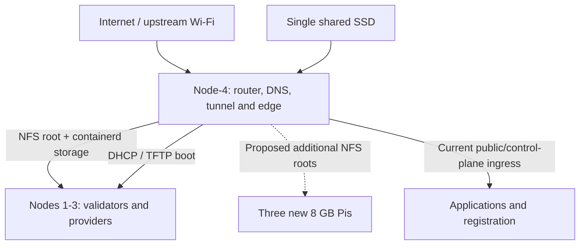

# Node-4 responsibilities and proposed seven-node production cluster

Assessment date: November 16, 2026. Read-only inspection of the four existing, identity-verified machines. The three additional Raspberry Pi 4B 8 GB machines are user-reported hardware, not yet inspected or enrolled. Node-5/6/7 below are proposed labels, not assigned identities or addresses. This document changes neither deployment inventory nor installation authorization.

See the [completed Ansible source inspection](ANSIBLE_EXPANSION_INSPECTION_2026-11-16.md) for exact role boundaries and expansion blockers.

## Assessment

Node-4 is not currently short of CPU or RAM. It combines boot, shared root storage, routing, DNS, public ingress and control-plane endpoints on one 4 GB Pi. Its failure can impair every validator at once. Adding three netboot clients increases this dependency rather than removing it.

**Engineering assessment of the proposed expansion with all six other nodes dependent on node-4: 4/10 for production infrastructure readiness.** It is a plausible small founder-operated network, but it is not demonstrated high availability. This is a qualitative engineering score, not a benchmark, probability of failure, security certification or release acceptance result. Source completion and permission repairs do not resolve the shared failure domain.

## Observed hardware and light-load snapshot

The utilization sample lasted approximately ten seconds, with collection overhead present. It does not establish peak or sustained customer capacity.

| Node | Observed model | Nominal RAM | OS-available RAM at sample | CPU busy across all cores | SoC temperature |
|---|---|---:|---:|---:|---:|
| 1 | Pi 4B Rev 1.5 | 8 GB | 4.67 GiB | 6.8% | 41.4°C |
| 2 | Pi 4B Rev 1.5 | 8 GB | 6.95 GiB | 3.3% | 54.5°C |
| 3 | Pi 4B Rev 1.5 | 8 GB | 6.96 GiB | 3.2% | 50.6°C |
| 4 | Pi 4B Rev 1.4 | 4 GB | 3.15 GiB | 3.4% | 75.5°C, then 76.4°C |

Node-4 reports 3.70 GiB total OS-visible memory; nodes 1–3 report 7.62 GiB each. All four wired interfaces negotiate 1,000 Mb/s full duplex. Node-4's sampled Ethernet traffic was approximately 2.54 Mb/s receive and 10.47 Mb/s transmit, far below link rate in this sample. This is not a network throughput benchmark.

Node-4 boots from an SD-card root filesystem, approximately 29 GiB with 23 GiB available. The shared storage device identifies as a **SanDisk SSD PLUS 1000GB**, connected at USB 3 link speed (5,000 Mb/s), using the `usb-storage` driver. The mounted shared ext4 filesystem reports approximately 787 GiB total, 166 GiB used and 581 GiB available (23% used). The USB bridge reports rotational=true despite the SSD model string; do not infer actual media type or performance from that flag alone. SMART's overall health check passed; endurance, complete attributes, sustained latency, power-loss behavior and recovery have not been qualified. Other partitions exist and are not counted as available shared capacity.

## Node-4 job inventory

| Responsibility | Observed implementation/state | Dependency and production implication |
|---|---|---|
| LAN DHCP | `dnsmasq`, UDP 67, bound configuration for Ethernet | Issues addresses/boot-network configuration. Outage affects new clients and lease renewal; established leases do not vanish immediately. |
| DNS forwarding/cache | `dnsmasq`, TCP/UDP 53; configured external resolvers | Name resolution dependency for clients using it. Listener exposure alone does not prove external reachability; firewall boundaries need acceptance testing. |
| Network boot transfer | `tftpd-hpa` running, UDP 69 | Supplies boot artifacts. Outage prevents affected nodes from booting; this is separate from runtime NFS dependency. |
| Root filesystem and shared-data server | NFS server, mountd, rpcbind, idmapd, related helpers; separate rootfs/data exports for nodes 1–3 | Their live root filesystems and containerd stores reside on these NFS roots. Losing node-4, its SSD or storage connectivity can stall all three validators/providers. |
| LAN routing/NAT | IPv4/IPv6 forwarding enabled, nftables contains masquerade; node-4 owns the clients' LAN default-gateway address | Client default routes lead to node-4. Node-4's own observed default route is via `wlan0`. Outbound internet therefore depends on this host and Wi-Fi path. No throughput or firewall audit is implied. |
| Public tunnel ingress | `cloudflared` running | Carries tunnel traffic for configured public services. Exact public host routing was not inspected; tunnel credentials were not read. |
| HTTP/application edge | Apache running, HTTP 80 and loopback 8081 listeners | Web/proxy edge. Route ownership and end-to-end customer application behavior still need an endpoint inventory/acceptance test. |
| Private registration RPC TLS gateway | `greenwood-h8-rpc`, Apache listener on LAN port 19446 | Private registration/control-plane gateway; dependency on node-4 availability. |
| Authenticated assignment receiver | `greenwood-assignment-receiver`, PHP listener on LAN port 19445 | Receives assignments for node-4's role. Presence is not a successful deployment test. |
| Deployment-readiness endpoint | `greenwood-deployment-readiness`, loopback PHP listener 8091 | Read-only readiness service. Working-directory ownership was corrected in the preceding repair. |
| Edge reconciliation | `greenwood-edge-reconcile.timer` active; observed one-minute schedule | Scheduled reconciliation. The associated oneshot being inactive between successful runs is normal, not a failed daemon. |
| Policy refresh | `greenwood-h8-policy-pull.timer` active; observed roughly 30-second cadence | Periodic policy retrieval. Snapshot caught one invocation activating with Result=success; this is not proof that all later invocations succeed. |
| VPN interface | `wg-quick@wg0` enabled/active-exited, `wg0` present, UDP 51820 listener | VPN configured. No peers, keys or end-to-end recovery reachability were inspected; not a verified out-of-band recovery path. |
| Administration and OS upkeep | SSH, time synchronization, logging, SMART daemon, cron, update and sysstat timers; other standard OS daemons | Operational maintenance, not spare customer capacity. Review update/reboot policy and monitoring coverage before cutover. Serial getty presence does not prove accessible recovery hardware. |

`greenwood-edge-admission.service` is disabled/inactive; do not count it as an active protection. The broader audit found the deployment controller disabled on node-1. Production service placement must reconcile these states with the required release topology.

Node-4 currently does **not** run a Greenwood validator/provider/containerd service in the inspected deployment. The registry and registry-auth services currently run on **node-1**, not node-4. Do not move every remaining production service onto node-4 just because it is called the gateway. Metering/attestation production acceptance is not established by this inventory.

## Failure relationships

This shows service dependencies, not packet direction or a redundant topology. Booting a new infrastructure node from node-4's NFS while calling it a backup does not make it independent of node-4. A replicated disk directory alone is also not tested NFS failover: consistency, client recovery, service identity, fencing and activation need a designed and exercised procedure.

All machines remain under DreamBIG's administration. More servers provide hardware capacity, not independent operators, independent attestation or automatically distributed governance. Do not infer consensus fault tolerance from the number of Pis without validating Greenwood's actual quorum and recovery behavior.

## Thermal finding

The firmware reading confirmed **76.4°C**. `vcgencmd get_throttled` returned **0x80000**: the historical soft-temperature-limit bit is set, while current undervoltage/frequency-cap/throttling/soft-limit bits are clear. It does **not** establish current throttling or prove why the earlier event occurred. The official [Raspberry Pi utility documentation](https://www.raspberrypi.com/documentation/computers/os.html#vcgencmd) defines these flags.

Check node-4's fan, heatsink contact, enclosure airflow, dust and ambient temperature before adding load. Do not diagnose the physical cause remotely or solve this by raising thermal limits. Raspberry Pi describes temperature-related clock limiting around 80–85°C in its [configuration documentation](https://www.raspberrypi.com/documentation/computers/config_txt.html). Require sustained representative-load evidence and acceptable thermal margin, not just a cool idle sample after a reboot.

## Expanded-cluster rating

Scale: 1–2 = critical limitation/unproven recovery; 3–4 = important production gaps; 5–6 = plausible controlled pilot; 7–8 = measured and operationally qualified; 9–10 = strong tested fault isolation/recovery. Scores are judgments on this proposed layout, not mathematically combined into a capacity forecast.

| Dimension | Score / 10 | Reason |
|---|---:|---|
| CPU suitability for small ARM services | 6, provisional | Seven Pi 4B boards offer 28 physical CPU cores in aggregate. Suitable workload classes are plausible, but no representative production load test or payable throughput qualification exists here. |
| Memory headroom | 7, provisional | 52 GB nominal RAM across the proposed seven boards. It is distributed memory, not one shared pool; OS, validators and system-service reserves reduce rentable capacity. |
| Storage design | 3 | Space remains, but one shared SSD/NFS host holds live roots and runtime stores. Latency, locking, concurrent image pulls and recovery remain unqualified. |
| Network design | 3 | Wired client links are gigabit, but node-4's shared link and observed Wi-Fi uplink constrain aggregate paths. Switch/uplink capacity and failure behavior are unverified. |
| Failure isolation / availability | 2 | One node/storage path can impair every validator and all proposed netboot clients. A seven-node count does not fix this. |
| Thermal readiness | 3 | Node-4 is hot under light sampled load and has a historical soft-limit flag. New nodes' cooling is unknown. |
| Recovery readiness | 2 | No verified independent recovery access, restore exercise or node-4 outage rehearsal. Backups and a restore procedure have not been demonstrated by this audit. |
| Overall production infrastructure readiness | **4** | Promising founder-operated deployment hardware; shared dependencies and physical acceptance remain material gates. |

Official [Pi 4 specifications](https://www.raspberrypi.com/products/raspberry-pi-4-model-b/specifications/) document the quad-core CPU, gigabit Ethernet and USB 3 interfaces. Aggregate cores/RAM are inventory arithmetic, not equivalent x86/cloud performance, transferable GRU capacity or benchmark results. No GPU/NPU payable capability is inferred.

## Recommended seven-node allocation

This is a proposed target for review, not an instruction already executed.

| Node | Recommended primary role | Conditions |
|---|---|---|
| 1–3, 8 GB each | Validators A/B/C; reserve resources for consensus | Existing providers remain until a reviewed migration. Prefer moving general customer workloads to new provider hosts. For meaningful node-4 failure isolation, validator root/ledger/runtime storage must cease depending on node-4 or have genuinely qualified redundancy. |
| 4, 4 GB | Boot/storage infrastructure and LAN services during the transition | Fix cooling first. Avoid adding customer compute, registry, controller or heavy monitoring. Reduce public/application responsibilities through a planned migration, preserving boot availability. |
| Proposed 5, 8 GB | Infrastructure services: registry/auth, metering coordinator, modest monitoring, and planned application/control-plane edge relocation; the local-provider deployment controller stays on node-1 | Local boot/storage independent of node-4 is strongly preferred. Exact placement and memory/disk budgets need validation. Moving services here does not by itself create redundant services or remove node-4's router dependency. |
| Proposed 6–7, 8 GB each | Customer CPU/RAM application providers | Install supported meters and enforce reservations; retain capacity for OS/runtime/system services. Meter agents belong on the provider hosts. Local runtime storage is preferable; NFS use must be explicitly qualified. |

This trades one of the three potential new compute providers for infrastructure separation. The two proposed provider hosts total eight cores and 16 GB nominal RAM before overhead. If all three new machines instead become providers, they add twelve cores/24 GB nominal RAM but leave infrastructure concentration unresolved.

The same seven physical machines can support this role separation; it does not require another qualification cluster. Available local boot media, storage and recovery access on the new machines are unknown. Do not assume extra disks exist or assign unverified IPs. If only netboot is presently practical, label the result a single-storage-host deployment with planned downtime and explicitly accepted availability limits. Network boot itself is supported; its root-filesystem dependency is documented in Raspberry Pi's [network-boot example](https://www.raspberrypi.com/documentation/computers/remote-access.html).

## Before cutover

1. Inspect node-4 cooling and power, then observe temperature/flags through representative sustained load. Record the existing historical flag rather than treating it as a new incident.
2. Decide the boot/storage layout for the three new Pis and confirm their identities, disks, cooling and recovery access. Do not add six NFS-root clients before validating concurrent boot and workload I/O.
3. Review how to remove validator dependence on node-4, or explicitly accept and document that a node-4 outage can stop the network. Test the applicable consensus recovery behavior without guessing quorum tolerance.
4. Plan a wired production uplink and firewall/ingress verification using the existing network where possible; validate DNS, DHCP, NAT, VPN and customer routes. Moving web services to node-5 does not replace the existing router.
5. Define offline/restorable backups of boot files, NFS configuration, OS/root images and necessary production state, with appropriate secret custody. Test restore and node-4 recovery before claiming recoverability. Obsolete testnet ledger preservation is not required.
6. Measure concurrent application execution, image pulls, storage latency, NFS stalls, CPU/RAM meters and sustained thermal behavior on the intended placement. Set capacity limits from those measurements. Test restart/recovery with explicit maintenance authorization and verified recovery access.
7. Update the private production inventory, service-placement manifests and installation procedure only after the proposed additions/roles are confirmed. Reconcile disabled services. Keep governance ratification and explicit destructive-installation approval separate and unresolved until supplied.

No infrastructure changes were made during this assessment. It is not authorization for migration, reboot, partitioning or permanent genesis.

## Evidence and limits

Machine-specific evidence remains private under `build/cluster-assessment-2026-11-16/`: four initial observation files, four follow-up files and the exact read-only collection scripts. Same-day permission-audit preflight evidence confirms node-4's gateway-address alias; current route observations confirm the client/default paths. No signing, VPN or tunnel keys were read. Public hostname mappings and protected environment files were not inspected.

The evidence is a short live snapshot, not a capacity stress test, uptime study or independent audit. New-node hardware and workload requirements remain unmeasured. Source-publication status, monetary invariants and pending governance decisions are unaffected.
